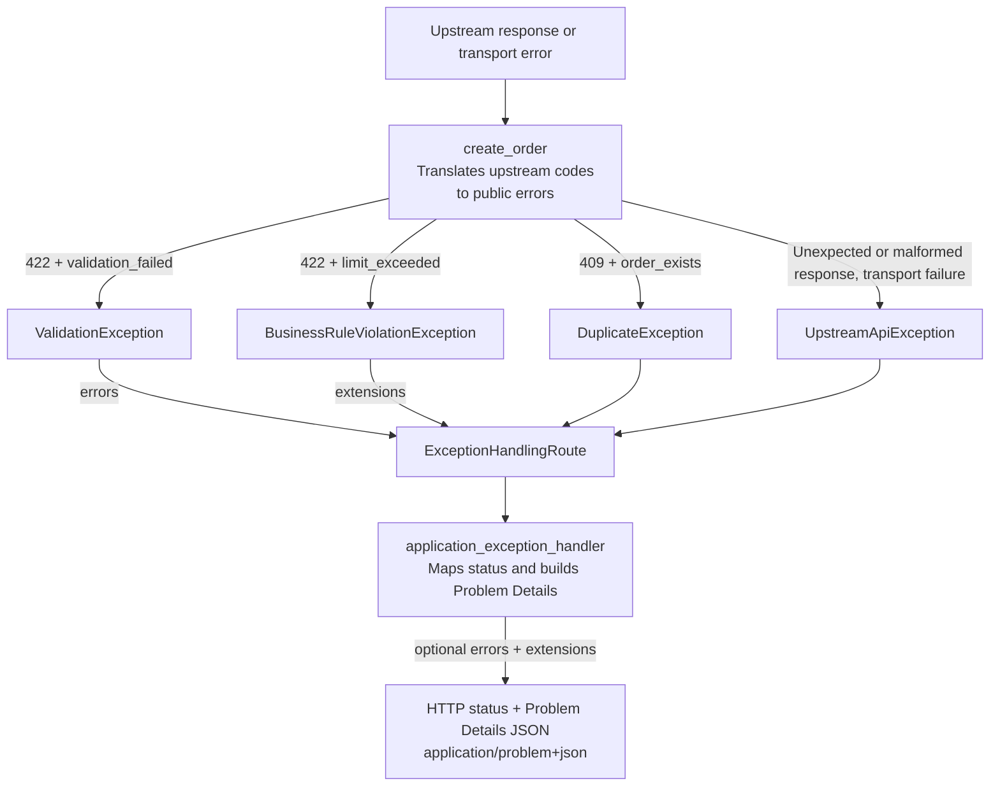

# Team Hermes FastAPI Error Handling

Core exceptions describe **what went wrong**; this package decides **how to
represent it over HTTP**, turning them into consistent JSON error responses and
logging them.

**Requires:** Python 3.12+, FastAPI, Pydantic 2+, Starlette, and `team-hermes-core>=0.1.0`.

## Installation

From the repository root, build and install the package with its dependencies:

```shell
mise run python:build
uv pip install --find-links team-hermes-packages-python/dist \
  team-hermes-packages-python/dist/team_hermes_fastapi_error_handling-*.whl
```

Omit `--find-links` when core is available from your configured package source.

## Quick Start

Set `ExceptionHandlingRoute` on the router to turn Hermes exceptions into
Problem Details responses.

This app approves orders, returning 404 for a missing order, 400 for a non-positive
total, and 422 when the purchasing limit is exceeded. The dictionary is example
storage; replace it with your application's data access.

```pycon
>>> from fastapi import APIRouter, FastAPI
>>> from pydantic import BaseModel

>>> from team_hermes.core import (
...     BusinessRuleViolationException,
...     NotFoundException,
...     ValidationException,
... )
>>> from team_hermes.fastapi_error_handling import ExceptionHandlingRoute

>>> app = FastAPI()
>>> router = APIRouter(route_class=ExceptionHandlingRoute)
>>> orders = {"order-1": 50}

>>> class OrderApproval(BaseModel):
...     total: int
...

>>> def approve_order(order_id: str, total: int) -> dict[str, str | int]:
...     if order_id not in orders:
...         raise NotFoundException("Order not found", extensions={"orderId": order_id})
...     if total <= 0:
...         raise ValidationException(
...             "Order total must be positive",
...             title="Order validation failed",
...             errors=[
...                 {
...                     "pointer": "#/total",
...                     "code": "positive_total_required",
...                     "detail": "Total must be positive",
...                 }
...             ],
...         )
...     if total > 100:
...         raise BusinessRuleViolationException(
...             "Order total exceeds the purchasing limit",
...             extensions={
...                 "ruleCode": "order_limit_exceeded",
...                 "limit": 100,
...                 "requestedTotal": total,
...             },
...         )
...     orders[order_id] = total
...     return {"id": order_id, "status": "approved", "total": total}
...

>>> @router.post("/orders/{order_id}/approval")
... def approve(order_id: str, body: OrderApproval):
...     return approve_order(order_id, body.total)
...
>>> app.include_router(router)

```

Errors return `application/problem+json` responses.

## Configured Example

Run this after Quick Start to build a new app with optional configuration,
reusing the same approval endpoint.

```pycon
>>> import logging
>>> from collections import Counter
>>> from contextvars import ContextVar
>>> from functools import partial
>>> from uuid import uuid4

>>> from starlette.exceptions import HTTPException
>>> from starlette.requests import Request
>>> from starlette.responses import Response

>>> from team_hermes.core import UpstreamApiException
>>> from team_hermes.fastapi_error_handling import (
...     ErrorHandlingConfig,
...     ProblemDetails,
...     build_common_extensions,
...     framework_http_exception_handler,
... )
>>> from team_hermes.fastapi_error_handling.exception_handling.responses import (
...     create_response,
...     responses,
... )

>>> logging.basicConfig(level=logging.INFO)
>>> request_trace_id: ContextVar[str] = ContextVar("request_trace_id", default="")
>>> error_counts: Counter[str] = Counter()

>>> # A process-local metric; replace with your monitoring client's counter.
>>> def record_exception(exception: Exception) -> None:
...     error_counts[type(exception).__name__] += 1
...

>>> # Custom handlers build their own response without exposing private error text.
>>> def handle_timeout(
...     request: Request,
...     exception: Exception,
...     config: ErrorHandlingConfig,
... ) -> Response:
...     config.logger.error("Order service timed out")
...     return ProblemDetails(
...         type=config.problem_type_for(exception),
...         title="Service unavailable",
...         status=503,
...         detail="Order service timed out",
...         extensions=build_common_extensions(request, config=config),
...     ).to_response()
...

>>> # All settings are optional; omitted settings use defaults.
>>> # First matching class wins; put subclasses first.
>>> # Callbacks must be synchronous and should not raise.
>>> config = ErrorHandlingConfig(
...     # Optional: choose the logger for built-in handlers.
...     logger=logging.getLogger("orders.errors"),
...     # Optional: override HTTP statuses by exception class.
...     status_map={UpstreamApiException: 502},
...     # Optional: supply extensions.traceId from request context.
...     trace_id_provider=request_trace_id.get,
...     # Optional: add public response metadata under extensions.
...     extension_provider=lambda request: {"apiVersion": "v1", "method": request.method},
...     # Optional: observe application and fallback exceptions for telemetry.
...     exception_observer=record_exception,
...     # Optional: handle exception types not covered by built-in handlers.
...     exception_handlers={TimeoutError: handle_timeout},
...     # Optional: override Problem Details type URIs by exception class.
...     problem_type_map={
...         NotFoundException: "/docs/problems/order-not-found",
...         TimeoutError: "/docs/problems/order-timeout",
...     },
... )
>>> app = FastAPI()

>>> # Optional: reuse or generate a trace ID, keeping concurrent requests separate.
>>> @app.middleware("http")
... async def correlate_request(request: Request, call_next):
...     trace_id = (
...         request.headers.get("X-Trace-Id")
...         or request.headers.get("traceparent")
...         or uuid4().hex
...     )
...     token = request_trace_id.set(trace_id)
...     try:
...         return await call_next(request)
...     finally:
...         request_trace_id.reset(token)
...

>>> # Optional: return Problem Details for HTTP errors outside wrapped routes,
>>> # including routing errors such as 404 and 405.
>>> app.add_exception_handler(
...     HTTPException,
...     partial(framework_http_exception_handler, config=config),
... )

>>> # Apply this configuration before adding routes to the router.
>>> # Other routers need their own ExceptionHandlingRoute configuration.
>>> router = APIRouter(
...     # Required for this router to use Hermes error handling.
...     route_class=ExceptionHandlingRoute.with_config(config),
...     # Optional: document error responses in OpenAPI; this does not enable handling.
...     responses={
...         **responses,
...         502: create_response(UpstreamApiException()),
...         503: {**responses[500], "description": "Order service timed out"},
...     },
... )

>>> router.add_api_route("/orders/{order_id}/approval", approve, methods=["POST"])
>>> app.include_router(router)

```

## Problem Details

Use `errors` for individual field-validation findings and `extensions` for
metadata, such as trace IDs and business-rule codes. A response can contain both.

The responses below use the configured example.

**Business-rule rejection (`extensions`):** send a request above the purchasing limit:

```shell
curl -i http://127.0.0.1:8000/orders/order-1/approval \
  -H 'Content-Type: application/json' \
  -H 'X-Trace-Id: example-trace' \
  -d '{"total": 150}'
```

The request returns **422** and `Content-Type: application/problem+json`, with a generated
`errorId` for each occurrence:

```json
{
  "type": "/docs/problems/business-rule-violation",
  "title": "Business Rule Violation",
  "status": 422,
  "detail": "Order total exceeds the purchasing limit",
  "extensions": {
    "requestPath": "/orders/order-1/approval",
    "traceId": "example-trace",
    "errorId": "2ee44ba8-d14b-413f-ae31-099d8f6bb75e",
    "severity": "ERROR",
    "apiVersion": "v1",
    "method": "POST",
    "ruleCode": "order_limit_exceeded",
    "limit": 100,
    "requestedTotal": 150
  }
}
```

**Field validation (`errors` + `extensions`): `400 Bad Request`**

```shell
curl -i http://127.0.0.1:8000/orders/order-1/approval \
  -H 'Content-Type: application/json' \
  -H 'X-Trace-Id: example-trace' \
  -d '{"total": 0}'
```

```json
{
  "type": "/docs/problems/validation-error",
  "title": "Order validation failed",
  "status": 400,
  "detail": "Order total must be positive",
  "errors": [
    {
      "pointer": "#/total",
      "code": "positive_total_required",
      "detail": "Total must be positive"
    }
  ],
  "extensions": {
    "requestPath": "/orders/order-1/approval",
    "traceId": "example-trace",
    "errorId": "2ee44ba8-d14b-413f-ae31-099d8f6bb75e",
    "severity": "ERROR",
    "apiVersion": "v1",
    "method": "POST"
  }
}
```

Responses follow [RFC 9457](https://www.rfc-editor.org/info/rfc9457/), use
`application/problem+json`, and omit absent optional fields. Field findings go in
top-level `errors`; metadata goes in `extensions`. Clients should identify errors
by `type` and documented codes, not by matching the text in `detail`.

The application examples use `errors[].pointer`, such as `#/total`. FastAPI request
validation uses `errors[].source.pointer`, such as `/body/total`; Pydantic model
validation uses the same member with dot-separated paths. Clients should handle
both shapes.

## Exception-to-HTTP Status Mapping

Default HTTP statuses by exception class:

### Application Exceptions

| Exception                        | Description                                                  | Status |
| -------------------------------- | ------------------------------------------------------------ | ------ |
| `ValidationException`            | Invalid application input                                    | 400    |
| `UnauthorizedException`          | Missing or invalid credentials; no `WWW-Authenticate` header | 401    |
| `MissingPrivilegeException`      | Insufficient permissions                                     | 403    |
| `NotFoundException`              | A missing required resource                                  | 404    |
| `ConflictException`              | A conflict with current state                                | 409    |
| `DuplicateException`             | A uniqueness violation                                       | 409    |
| `BusinessRuleViolationException` | A rejected business rule                                     | 422    |
| `UpstreamApiException`           | An upstream service failure                                  | 500    |
| `ApplicationException`           | No more specific status mapping                              | 500    |

See the [core exception guide](../core/README.md#choosing-an-exception).

### Framework and Unhandled Errors

| Exception                                    | Description                                                      | Status        |
| -------------------------------------------- | ---------------------------------------------------------------- | ------------- |
| `fastapi.exceptions.RequestValidationError`  | Invalid FastAPI request input                                    | 422           |
| `pydantic.ValidationError`                   | Invalid Pydantic model data                                      | 422           |
| `starlette.exceptions.HTTPException`         | Includes the `fastapi.HTTPException` subclass; preserves headers | `status_code` |
| `fastapi.exceptions.ResponseValidationError` | Invalid FastAPI response data                                    | 500           |
| `builtins.Exception`                         | Other unhandled errors                                           | 500           |

## Usage Guidelines

### When to Return or Raise

Return expected results; raise when the operation cannot proceed.

**Empty search:** no matches is a valid result.

```pycon
>>> order_statuses = {"order-1": "pending"}

>>> def search_orders(status: str) -> list[str]:
...     return [
...         order_id
...         for order_id, current in order_statuses.items()
...         if current == status
...     ]
...

>>> search_orders("approved")
[]

```

**Optional lookup:** return `None` when absence is allowed.

```pycon
>>> def find_order_status(order_id: str) -> str | None:
...     return order_statuses.get(order_id)
...

>>> find_order_status("missing") is None
True

```

**Required lookup:** raise when a required record is missing.

```pycon
>>> from team_hermes.core import NotFoundException

>>> def require_order_status(order_id: str) -> str:
...     status = find_order_status(order_id)
...     if status is None:
...         raise NotFoundException("Order not found")
...     return status
...

>>> require_order_status("order-1")
'pending'
>>> require_order_status("missing")
Traceback (most recent call last):
...
team_hermes.core.exceptions.NotFoundException: Order not found

```

**Validation check:** return findings when checking data is the operation.

```pycon
>>> def check_total(total: int) -> list[dict[str, str]]:
...     if total > 0:
...         return []
...     return [
...         {
...             "field": "total",
...             "code": "positive_total_required",
...             "message": "Total must be positive",
...         }
...     ]
...

>>> check_total(50)
[]
>>> check_total(0)
[{'field': 'total', 'code': 'positive_total_required', 'message': 'Total must be positive'}]

```

A rejected create or save raises instead. Failures that prevent a check from
running still propagate.

### Exception Propagation

**Raise once; let the handler catch it.** `ExceptionHandlingRoute` logs the
exception and creates the response. Catch only to recover or translate, not to
log and re-raise. Use context managers or `finally` for cleanup; never return exceptions.

```pycon
>>> from fastapi import APIRouter, FastAPI
>>> from fastapi.testclient import TestClient

>>> from team_hermes.core import NotFoundException
>>> from team_hermes.fastapi_error_handling import ExceptionHandlingRoute

>>> def load_order(order_id: str) -> dict[str, str]:
...     raise NotFoundException("Order not found", extensions={"orderId": order_id})
...

>>> error_app = FastAPI()
>>> error_router = APIRouter(route_class=ExceptionHandlingRoute)

>>> @error_router.get("/orders/{order_id}")
... def get_order(order_id: str):
...     return load_order(order_id)
...
>>> error_app.include_router(error_router)

>>> with TestClient(error_app) as client:
...     response = client.get("/orders/missing")
...
>>> response.status_code
404
>>> response.json()["detail"]
'Order not found'
>>> response.json()["extensions"]["orderId"]
'missing'

```

### Upstream Failures

Translate known rejections into application exceptions; unexpected responses
become `UpstreamApiException`. This example uses HTTPX.



- **`errors`** lists individual validation findings, such as a field's code, message, and location.
- **`extensions`** holds additional context, such as trace IDs, request metadata, or business-rule codes.

A response can contain both.

```pycon
>>> import httpx
>>> from pydantic import BaseModel, Field, ValidationError

>>> from team_hermes.core import (
...     BusinessRuleViolationException,
...     DuplicateException,
...     UpstreamApiException,
...     ValidationException,
... )

>>> # Keep upstream findings separate from public fields.
>>> class CreatedOrder(BaseModel):
...     id: str
...     total: int
...

>>> class OrderItem(BaseModel):
...     quantity: int
...

>>> class FieldFinding(BaseModel):
...     pointer: str
...     code: str
...     detail: str
...

>>> class UpstreamFinding(BaseModel):
...     field: str
...     code: str
...     index: int | None = Field(default=None, ge=0, strict=True)
...

>>> class UpstreamValidation(BaseModel):
...     errors: list[UpstreamFinding] = Field(min_length=1)
...

>>> # Map known fields and codes; indices must refer to submitted items.
>>> def translate_findings(payload: object, item_count: int = 0) -> list[FieldFinding]:
...     try:
...         report = UpstreamValidation.model_validate(payload)
...     except ValidationError as error:
...         raise UpstreamApiException(
...             "Order service returned invalid validation data"
...         ) from error
...
...     findings: list[FieldFinding] = []
...     for finding in report.errors:
...         match (finding.field, finding.code, finding.index):
...             case ("order_total", "too_small", None):
...                 public_finding = FieldFinding(
...                     pointer="#/total",
...                     code="positive_total_required",
...                     detail="Total must be positive",
...                 )
...             case ("line_items.qty", "too_small", int() as index) if index < item_count:
...                 public_finding = FieldFinding(
...                     pointer=f"#/items/{index}/quantity",
...                     code="positive_quantity_required",
...                     detail="Quantity must be positive",
...                 )
...             case _:
...                 raise UpstreamApiException(
...                     "Order service returned unsupported validation findings"
...                 )
...         findings.append(public_finding)
...     return findings
...

>>> # Chain parsing and transport exceptions, not HTTP response objects.
>>> def create_order(
...     client: httpx.Client,
...     total: int,
...     items: list[OrderItem] | None = None,
... ) -> CreatedOrder:
...     request_body: dict[str, object] = {"total": total}
...     if items is not None:
...         request_body["line_items"] = [{"qty": item.quantity} for item in items]
...
...     try:
...         response = client.post("/orders", json=request_body)
...     except httpx.TimeoutException as error:
...         raise UpstreamApiException("Order service timed out") from error
...     except httpx.RequestError as error:
...         raise UpstreamApiException("Order service unavailable") from error
...
...     try:
...         payload = response.json()
...     except ValueError as error:
...         raise UpstreamApiException("Order service returned invalid JSON") from error
...
...     code = payload.get("code") if isinstance(payload, dict) else None
...     match (response.status_code, code):
...         case (200 | 201, _):
...             try:
...                 return CreatedOrder.model_validate(payload)
...             except ValidationError as error:
...                 raise UpstreamApiException(
...                     "Order service returned invalid order data"
...                 ) from error
...         case (422, "validation_failed"):
...             findings = translate_findings(payload, item_count=len(items or []))
...             raise ValidationException(
...                 "Order validation failed",
...                 title="Order validation failed",
...                 errors=[finding.model_dump(mode="json") for finding in findings],
...             )
...         case (422, "limit_exceeded"):
...             raise BusinessRuleViolationException(
...                 "Purchasing limit exceeded",
...                 extensions={"ruleCode": "order_limit_exceeded"},
...             )
...         case (409, "order_exists"):
...             raise DuplicateException("Order already exists")
...         case _:
...             raise UpstreamApiException("Order service rejected the request")
...

>>> # Expose the operation; let exceptions reach the route wrapper.
>>> from collections.abc import Iterator

>>> from fastapi import APIRouter, Depends, FastAPI

>>> from team_hermes.fastapi_error_handling import ExceptionHandlingRoute
>>> from team_hermes.fastapi_error_handling.exception_handling.responses import (
...     responses,
... )

>>> class CreateOrderRequest(BaseModel):
...     total: int
...     items: list[OrderItem] | None = None
...

>>> def get_order_client() -> Iterator[httpx.Client]:
...     with httpx.Client(base_url="https://orders.example", timeout=5.0) as client:
...         yield client
...

>>> orders_app = FastAPI()
>>> orders_router = APIRouter(route_class=ExceptionHandlingRoute, responses=responses)

>>> @orders_router.post("/orders", response_model=CreatedOrder, status_code=201)
... def submit_order(
...     body: CreateOrderRequest,
...     client: httpx.Client = Depends(get_order_client),
... ) -> CreatedOrder:
...     return create_order(client, body.total, body.items)
...
>>> orders_app.include_router(orders_router)

```

#### Request and Response Examples

**Success: `201 Created`**

```shell
curl -i http://127.0.0.1:8000/orders \
  -H 'Content-Type: application/json' \
  -d '{"total": 50}'
```

```json
{
  "id": "order-1",
  "total": 50
}
```

**Field validation: `400 Bad Request`**

```shell
curl -i http://127.0.0.1:8000/orders \
  -H 'Content-Type: application/json' \
  -H 'X-Trace-Id: example-trace' \
  -d '{"total": 0}'
```

```json
{
  "type": "/docs/problems/validation-error",
  "title": "Order validation failed",
  "status": 400,
  "detail": "Order validation failed",
  "errors": [
    {
      "pointer": "#/total",
      "code": "positive_total_required",
      "detail": "Total must be positive"
    }
  ],
  "extensions": {
    "requestPath": "/orders",
    "traceId": "example-trace",
    "errorId": "2ee44ba8-d14b-413f-ae31-099d8f6bb75e",
    "severity": "ERROR"
  }
}
```

**Nested array: `400 Bad Request`**

```shell
curl -i http://127.0.0.1:8000/orders \
  -H 'Content-Type: application/json' \
  -H 'X-Trace-Id: example-trace' \
  -d '{"total": 50, "items": [{"quantity": 2}, {"quantity": 0}]}'
```

```json
{
  "type": "/docs/problems/validation-error",
  "title": "Order validation failed",
  "status": 400,
  "detail": "Order validation failed",
  "errors": [
    {
      "pointer": "#/items/1/quantity",
      "code": "positive_quantity_required",
      "detail": "Quantity must be positive"
    }
  ],
  "extensions": {
    "requestPath": "/orders",
    "traceId": "example-trace",
    "errorId": "2ee44ba8-d14b-413f-ae31-099d8f6bb75e",
    "severity": "ERROR"
  }
}
```

**Purchasing limit: `422 Unprocessable Entity`**

```shell
curl -i http://127.0.0.1:8000/orders \
  -H 'Content-Type: application/json' \
  -d '{"total": 150}'
```

```json
{
  "type": "/docs/problems/business-rule-violation",
  "title": "Business Rule Violation",
  "status": 422,
  "detail": "Purchasing limit exceeded"
}
```

**Upstream timeout: `500 Internal Server Error`**

```shell
curl -i http://127.0.0.1:8000/orders \
  -H 'Content-Type: application/json' \
  -d '{"total": 150}'
```

```json
{
  "type": "/docs/problems/upstream-api-error",
  "title": "Upstream API Error",
  "status": 500,
  "detail": "Order service timed out"
}
```

A timed-out creation may have succeeded. No writes are retried without an idempotency guarantee.

#### Override the Validation Status

Use `422` instead of `400`, configuring the router before adding routes:

```pycon
>>> from team_hermes.fastapi_error_handling import ErrorHandlingConfig
>>> from team_hermes.fastapi_error_handling.exception_handling.responses import (
...     create_response,
... )

>>> validation_router = APIRouter(
...     route_class=ExceptionHandlingRoute.with_config(
...         ErrorHandlingConfig(status_map={ValidationException: 422}),
...     ),
...     responses={**responses, 422: create_response(ValidationException())},
... )

```

### Safe Metadata

**Treat `detail`, `errors`, and `extensions` as public, even on `500`.** Use
application-owned messages and stable codes, not upstream response bodies, URLs,
or credentials.

The Pydantic validation handler can include rejected input in `errors[].detail`.
Catch and translate these errors before they reach the handler when input may be
sensitive.

```pycon
>>> from team_hermes.core import UpstreamApiException

>>> error = UpstreamApiException(
...     "Catalog service unavailable",
...     extensions={"code": "catalog_unavailable"},
... )
>>> error.detail, error.extensions
('Catalog service unavailable', {'code': 'catalog_unavailable'})

```

### Logging

Choose the logger used by the exception handlers. Configure its handlers, format,
and redaction in your application.

```pycon
>>> import logging

>>> from fastapi import APIRouter

>>> from team_hermes.fastapi_error_handling import (
...     ErrorHandlingConfig,
...     ExceptionHandlingRoute,
... )

>>> logging_config = ErrorHandlingConfig(logger=logging.getLogger("example.errors"))
>>> logging_router = APIRouter(
...     route_class=ExceptionHandlingRoute.with_config(logging_config),
... )

```

### Custom Status Codes

Return `502` for `UpstreamApiException`; all other exceptions keep their default
status codes. Include the `502` response in OpenAPI:

```pycon
>>> from fastapi import APIRouter

>>> from team_hermes.core import UpstreamApiException
>>> from team_hermes.fastapi_error_handling import (
...     ErrorHandlingConfig,
...     ExceptionHandlingRoute,
... )
>>> from team_hermes.fastapi_error_handling.exception_handling.responses import (
...     create_response,
...     responses,
... )

>>> status_config = ErrorHandlingConfig(status_map={UpstreamApiException: 502})
>>> configured_router = APIRouter(
...     route_class=ExceptionHandlingRoute.with_config(status_config),
...     responses={**responses, 502: create_response(UpstreamApiException())},
... )

```

## Development

The README examples and response payloads are checked by pytest. Follow the
[workspace setup](../README.md), then run from the repository root:

```shell
mise run python:test -- fastapi-error-handling/tests
mise run python:lint
mise run python:typecheck
mise run python:build
```

## License

See [LICENSE](LICENSE).
